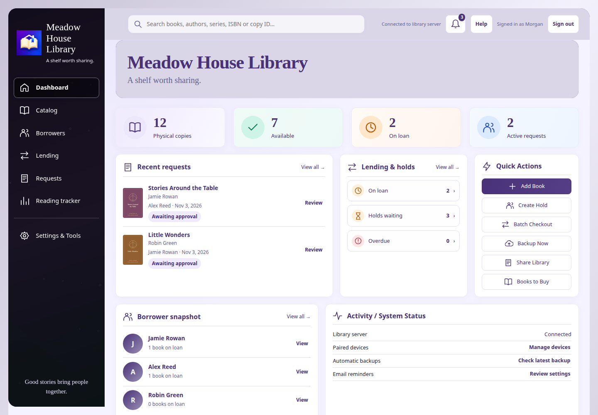

# Carribrary

Developed by **Chezburber Studios**. Support: **chezburbermerch@gmail.com**.

A self-hosted library for physical books. Keep the server on a Windows, Linux or Raspberry Pi computer; librarians and borrowers connect to it.

[Full feature list](FEATURES.md) · [Screenshot gallery](SCREENSHOTS.md)

## Install

Download the free server installer from the [2.0.59 public preview](https://github.com/MadZombie83/Carribrary/releases/tag/v2.0.59-preview): Windows EXE, Linux x86_64 Flatpak, or Pi ARM64 DEB. This is a testing release; make a complete backup before updating an existing library. The optional Android librarian companion is planned as a one-time US$15 Google Play purchase and is not yet publicly available. No Android APK or AAB is distributed here. Borrowers use their free browser/PWA link. iPhone librarians use the hosted Safari companion.

Most users do not need source code or build tools. Follow [installation instructions](home-library-native/INSTALLER-GUIDE.txt), then Help in the app.

## License

Carribrary-owned code is **source-available proprietary software**, not open source. The server is free to run for households, churches, schools and organizational libraries. You may inspect source and build the server for your own permitted use. Redistribution, resale, rebranding and offering a paid hosted service to unrelated customers require separate permission. See [LICENSE.txt](LICENSE.txt). Third-party rights remain separate: [notices](home-library-native/THIRD-PARTY-NOTICES.txt).

## Current preview

Current public preview: **2.0.59-preview**, with owner-built Windows, Flatpak and Raspberry Pi installers on the release page. See [current source Help](Carribrary-Help-2.0.59.md) and [release instructions](home-library-native/distribution/RELEASE-2.0.59.md). Public preview testing is open; this is not the final stable launch or a Google Play release. Real-device, scanner/card-printing, kiosk and Raspberry Pi acceptance remain in progress. Keep a verified complete backup on another device: older programs cannot safely open the upgraded library format. Source downloads do not change an installed library.

## Questions and bug reports

Use [Discussions](https://github.com/MadZombie83/Carribrary/discussions) for setup questions and testing feedback, and [Issues](https://github.com/MadZombie83/Carribrary/issues/new/choose) for reproducible bugs. Start with [Support](SUPPORT.md). Never post library backups, borrower information, passwords, API keys, pairing codes or private sharing links. Report suspected security problems privately using [Security](SECURITY.md).

## Developers and testers

[Current release readiness](home-library-native/distribution/RELEASE-READINESS-2.0.59.md) records completed checks and the [remaining device tests](home-library-native/distribution/DEVICE-CHECKLIST-2.0.59.md).

[Build source](home-library-native/BUILD-LOCALLY.md) or follow [Android test instructions](home-library-native/distribution/ANDROID-TESTING.md). Extract a source download to a new folder; do not merge it into installed programs or old build folders. Keep keys, library data and private configuration out of Git. Older Help/release files are historical records, not current setup directions.

The 2.0.59 preview includes the earlier setup/workflow improvements and repairs stale Quick Start and recovery version checks. Keep verified backups and use the supported recovery tools; do not bypass recovery guards.

## Current source: 2.0.59

The latest source synchronizes the illustrated Quick Start labels and repairs stale program-only and complete-data recovery version checks. It accepts supported format-7 complete archives through 2.0.59 while keeping future/mismatched archives blocked. Program-only recovery remains current-version only. See [2.0.59 changes](home-library-native/distribution/RELEASE-2.0.59.md), [validation](home-library-native/distribution/VALIDATION-2.0.59.md) and [source Help](Carribrary-Help-2.0.59.md). Matching owner-built 2.0.59 installers are available from the preview release above. Real Windows GUI and physical-device acceptance remain ongoing.
