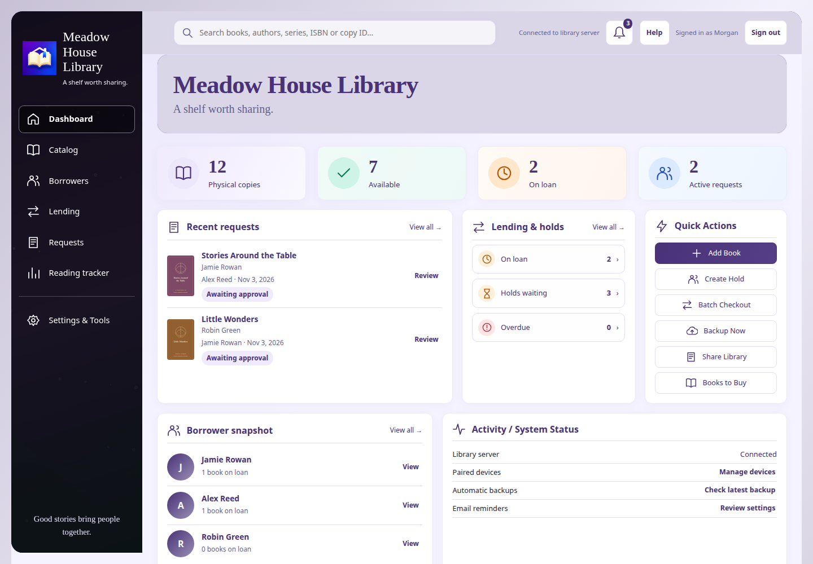
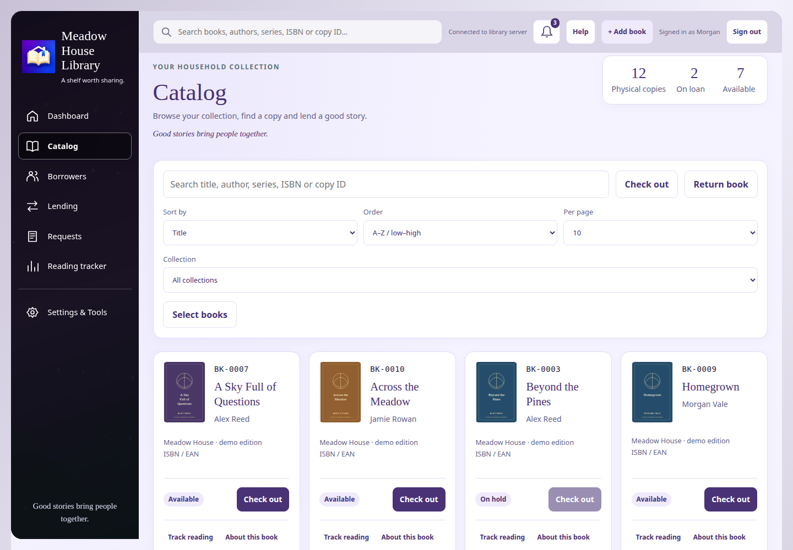
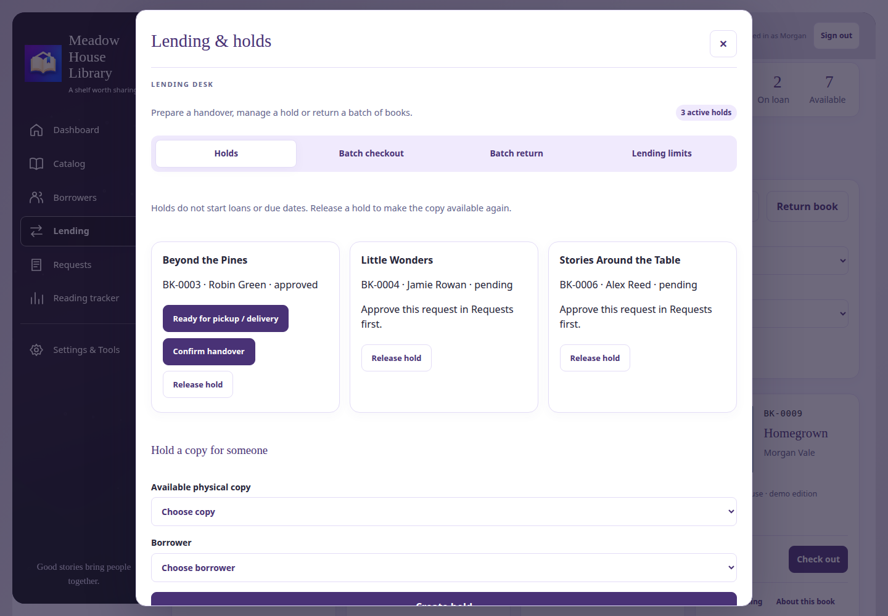
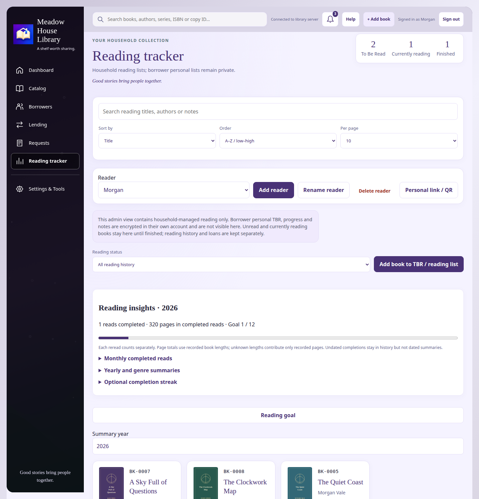
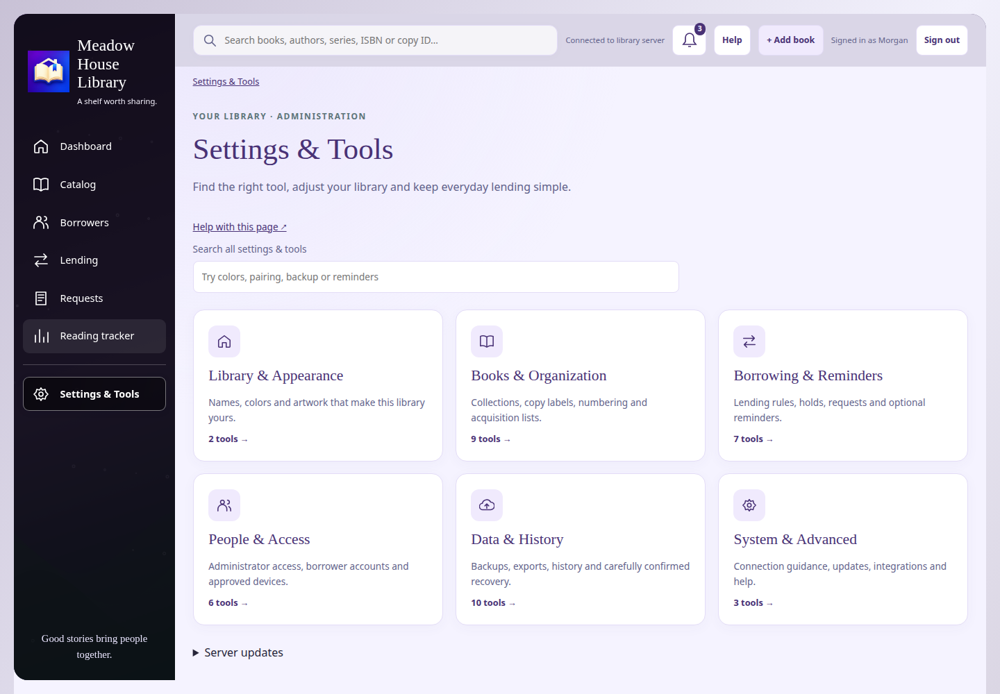
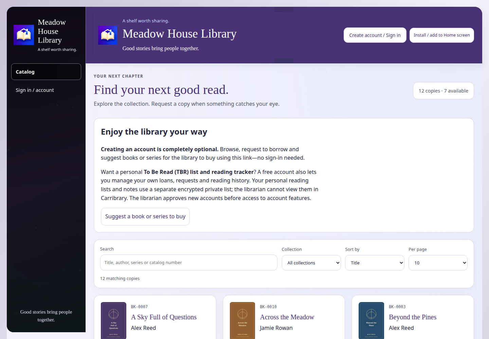
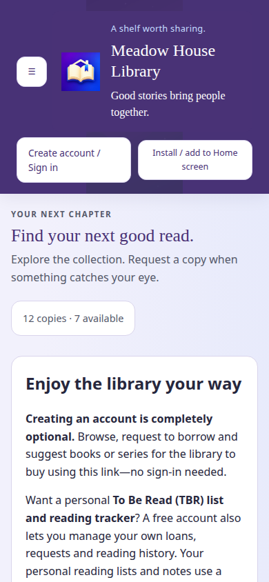
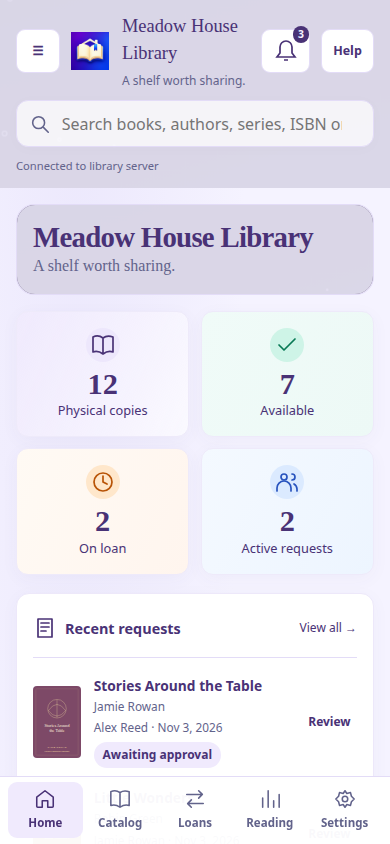
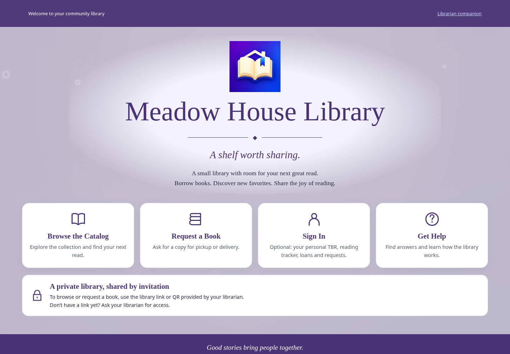
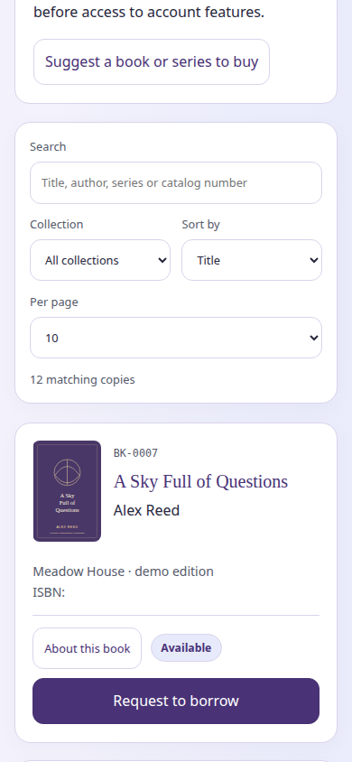

# Carribrary screenshots

Current installer release: **2.0.60-preview**. These earlier screenshots remain illustrative of the shared interface; they do not show the new Libraries & network wizard or household reader installation controls. See [current features](FEATURES.md) and [Help](Carribrary-Help-2.0.60.md) for those workflows.

Gallery captured from **2.0.59-preview** browser screens from the fictional **Meadow House Library**. The records, people, book covers and decorative artwork are demonstration material; no private library was used. These are screenshots of the working interface, not conceptual mockups.

Desktop images use a 1440-pixel-wide viewport. Mobile images use 390 × 844 browser viewports. The mobile companion image shows the hosted librarian browser/PWA interface; it is **not a native Android screenshot or a physical iPhone capture**. The theme shown is one sample configuration, not mandatory Carribrary branding.

[Full feature list](FEATURES.md) · [Server downloads](https://github.com/MadZombie83/Carribrary/releases)

Click an image to open its full-size PNG, then download/save it for your post. Keep a caption such as “Carribrary — sample library; theme and artwork are customizable.” Features requiring setup or permission are described in the feature list.

## Librarian dashboard

Physical copies, availability, loans, requests and everyday quick actions.

## Catalog

Cover thumbnails, search, sorting, page size and physical-copy availability.

## Lending & holds

Prepare holds and confirm handover before a loan begins.

## Household reading tracker

Household reader selection, TBR, reading status, goals and progress.

## Settings & Tools

Six organized settings categories with search and dedicated pages.

## Borrower catalog — desktop

Browse the shared catalog and request books; borrower accounts are optional.

## Borrower catalog — mobile welcome

Library branding and optional-account information at a phone-sized viewport.

## Librarian browser companion — mobile

The paired browser/PWA dashboard with mobile navigation and colored summary panels.

## Branded welcome page

The plain server address welcomes visitors without exposing the invitation token.

## Borrower catalog — mobile book cards

Search/filter controls, cover artwork, availability and borrowing requests.

